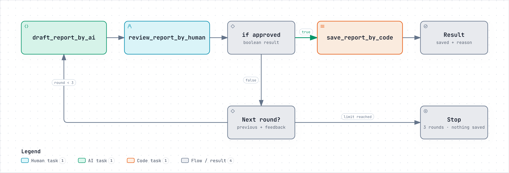

# OpenHilo

**AI, code, and humans. One workflow.**  
**人、AI、代码，尽在同一个工作流。**

Coordinate them with ordinary TypeScript functions, branches, and loops.



## Your TypeScript controls the workflow.

Call `_by_human`, `_by_ai`, and `_by_code` functions, pass typed results, and control
the flow with branches, loops, and calls between workflows.

```ts
export async function main(text: string): Promise<{ saved: boolean }> {
    const requirements = await provide_requirements_by_human("What should the summary focus on?");
    const summary = await summarize_text_by_ai(
        "analyst", "Summarize text in 1–2 sentences using focus. Return report; do not use tools.",
        text, requirements.focus
    );
    const saved = await save_summary_by_code("python", `
with open("summary.md", "x", encoding="utf-8") as output:
    output.write(report)
`, { report: summary.report });
    return { saved: saved.exit_code === 0 };
}
```

[Run this example](examples/compose-tasks/README.md) · [Full source and declarations](examples/compose-tasks/workflow.ts)

This is the actual entry function. OpenHilo compiles the
[documented TypeScript subset](packages/compiler/LANGUAGE.md); the host supplies the
executors. Workflow source is not a standalone Node script.

## Quick start

Use **Node 22 or 24**, npm, Bash and Python 3. No server, database or AI account is
needed for the scripted offline demo. Run from the repository root:

```sh
git clone https://github.com/eric2610abc/OpenHilo.git
cd OpenHilo
npm ci --ignore-scripts --no-audit --no-fund
npm run build:packages
node examples/compose-tasks/run.cjs --provider offline --input examples/compose-tasks/input.sample.json --output /tmp/openhilo-first
```

Enter a focus, such as `Release dates`, when asked. Open
`/tmp/openhilo-first/summary.md`. **Offline output is scripted, not AI-generated.**
Choose a new output directory each time.

For real AI, [install and sign in to Codex](docs/quickstart.md#install-and-sign-in-to-codex),
then run the same command with `--provider codex` and a new output directory.
[Environment help and installation details](docs/quickstart.md).

## Examples

### 1. Compose Human, AI and Code tasks

The example above collects Human requirements, processes text with AI, then writes
it with Code. Change the input text or your answer to try your own task.

[Run it →](examples/compose-tasks/README.md)

### 2. Pass files and directories

`FilePath` and `DirPath` mark path parameters and results. The document example
passes a brief and a directory of reference notes to Codex, then checks and reviews
the file it creates.

```ts
type FilePath = string;
type DirPath = string;

declare function draft_document_by_ai(role: string, prompt: string, brief: FilePath, references: DirPath): Promise<{ document: FilePath }>;
```

[Run document drafting and revision →](examples/document-review/README.md) · [Workflow source](examples/document-review/workflow.ts)

### 3. Branch, loop, and resume

The report review example uses a bounded loop and typed Human results:

```ts
export async function main(topic: string, notes: string): Promise<{ saved: boolean; rounds: number; reason: string }> {
    let previous: string = '';
    let feedback: string = '';
    for (let round = 1; round <= 3; round++) {
        const draft = await draft_report_by_ai(
            "writer", "Write 1–2 sentences using topic and notes. Revise previous using feedback. Return report. No tools.",
            topic, notes, previous, feedback, round
        );
        const review = await review_report_by_human(
            "Is this report ready to save? If not, tell us what needs changing. Leave feedback blank if no changes are needed.", draft.report, round
        );
        if (review.approved) {
            const result = await saveReport(draft.report);
            return {saved: result.saved, rounds: round, reason: result.reason};
        }
        previous = draft.report;
        feedback = review.feedback;
    }
    return {saved: false, rounds: 3, reason: "After 3 rounds the report was not approved; nothing saved"};
}
```

[Full loop, Code save and exit handling →](examples/review-report/workflow.ts)

Save a pending Human request and exit:

```sh
node examples/review-report/run.cjs --provider offline --input examples/review-report/input.sample.json --output /tmp/openhilo-paused --defer-human
```

In a new terminal, return to the repository root. Copy the printed **Records**
path into the command below:

```sh
node examples/review-report/resume.cjs --provider offline --run-dir "<printed Records path>"
```

The same review continues without repeating the completed AI step. Choose
`2 / No` and give revision instructions, then `1 / Yes` to save a later draft.
This example allows three reviews. Deferred input exits with status `2` intentionally.
[Recovery walkthrough and limits](examples/review-report/README.md#suspend-and-resume-in-another-process).

### More workflows and adapters

| Example | What it demonstrates |
| --- | --- |
| [Script repair](examples/script-repair/README.md) | Code runs tests → Codex edits files from real failures → Code retests; at most two repairs |
| [Local report](examples/local-report/README.md) | Python computes a summary → Human decides → Code saves; no AI needed |
| [SDK text](examples/sdk-text/README.md) | Direct OpenAI or Anthropic SDK text processing |
| [SDK tools](examples/sdk-tools/README.md) | A model uses an explicitly registered tool |

SDK examples are **experimental**: offline provider tests pass, but live API
behavior has not been verified. They require separate API credentials.

## Integrate OpenHilo

Use the compiler/runtime in your own host, or use individual executor packages.
Start with [embedding](docs/embedding.md) and [local package installation](docs/quickstart.md#embed-packages-from-local-tarballs).
The included AI adapters use Codex CLI or the official OpenAI/Anthropic SDKs.
There is no bundled Claude Code executor.

### Packages

One repository, twelve small packages. Install the dependency closure you need;
you do not need to install the whole repository into your application.

| Package             | Responsibility                                                                        |
|---------------------|---------------------------------------------------------------------------------------|
| [`itt-contracts`](packages/itt-contracts/README.md)     | ITT v2 graph, values and typed input contracts                                        |
| [`ai-contracts`](packages/ai-contracts/README.md)      | Provider-neutral AI task, questions, health, cancellation and result lifecycle        |
| [`human-contracts`](packages/human-contracts/README.md)   | Human requests, typed submissions and receipts                                        |
| [`runtime-contracts`](packages/runtime-contracts/README.md) | Shared execution types, events, errors and extension policy                           |
| [`studio-contracts`](packages/studio-contracts/README.md)  | Headless JSON presentation/configuration contracts; no Studio app or React dependency |
| [`compiler`](packages/compiler/README.md)          | Compile the supported TypeScript workflow DSL and its named relative imports          |
| [`runtime`](packages/runtime/README.md)           | Control flow, scoped values, nested calls, logs and controlled recovery               |
| [`tool-host`](packages/tool-host/README.md)         | Explicit tool registry, JSON Schema validation and result boundaries                  |
| [`ai-codex`](adapters/ai-codex/README.md)          | Codex CLI app-server adapter; optional React settings entry                           |
| [`ai-sdk`](adapters/ai-sdk/README.md)            | Official OpenAI/Anthropic SDK adapters and shared tool loop                           |
| [`code-local`](adapters/code-local/README.md)        | Host Bash/Python execution and typed results                                          |
| [`human-terminal`](adapters/human-terminal/README.md)    | Numbered business choices and typed answers                                           |

The included AI adapters are Codex CLI and the OpenAI/Anthropic SDK adapter.
There is no bundled Claude Code executor. Applications using Studio configuration
contracts should consult the [configuration boundary](packages/studio-contracts/README.md#ai-configuration-does-not-install-an-executor).

All package names have the `@openhilo/` prefix. Open a package's README under
`packages/` or `adapters/` for its API and installation dependencies.

## Supported scope

- **Workflow TypeScript:** a documented subset for orchestration, not full TS/Node execution. Complex computation and environment APIs belong in Code executors.
- **Recovery:** saved Human checkpoints preserve workflow state; arbitrary crash recovery and exactly-once external effects are not promised. Paths do not embed file contents.
- **Permissions:** Code and host tools run with host permissions. Codex's sandbox does not sandbox other executors.
- **Core library:** no bundled web UI, scheduler or application database. Supply host behavior through public interfaces.
- **Installation:** source checkout or local tarballs; `@openhilo/*` packages are not yet on npm. Node 22/24 are tested on macOS and Linux; native Windows is unverified.

## Documentation and contributing

[Documentation](docs/README.md) · [Language](packages/compiler/LANGUAGE.md) ·
[Execution model](docs/execution-model.md) · [Compatibility](docs/compatibility.md) ·
[Troubleshooting](docs/troubleshooting.md) · [Security](SECURITY.md)

For development, see [contributing](CONTRIBUTING.md) and [validation](docs/validation.md).
The offline test suite runs on Node 22 and 24 in
[GitHub Actions](https://github.com/eric2610abc/OpenHilo/actions/workflows/ci.yml).

[Report a bug](https://github.com/eric2610abc/OpenHilo/issues) ·
[MIT license](LICENSE) · [Third-party notices](THIRD_PARTY_NOTICES.txt)

### Choose AI by task

Use optional declaration tags to route tasks by type and level, with one direct model configuration per route. Try the [model-routing example](examples/model-routing/README.md) or read the [configuration guide](docs/ai-routing.md).
